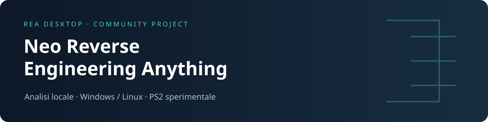
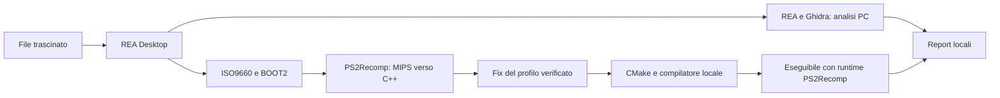

<p align="center"></p>

<p align="center"><strong>Un’interfaccia desktop per esplorare programmi e preparare progetti di ricompilazione PS2.</strong><br>Basata su REA di morluto e PS2Recomp di ran-j e contributori.</p>

<p align="center"><a href="#installazione">Installazione</a> · <a href="#come-si-usa">Uso</a> · <a href="controlli.md">Controlli</a> · <a href="CHANGELOG.md">Novità</a> · <a href="docs/STATO.md">Stato reale</a> · <a href="CREDITS.md">Autori</a></p>

> **Stato: sviluppo sperimentale, aggiornamento 21 ottobre 2026.**
> L’analisi desktop e la generazione di progetti sono disponibili. La ricompilazione PS2 non garantisce un gioco funzionante. Nel profilo BURNOUT SLES-53506 la tastiera conferma la lingua, ma il test si blocca successivamente nel percorso video e termina con `EE invocation stack space exhausted`. Non è una versione definitiva giocabile.

## Che cos’è

Neo Reverse Engineering Anything raccoglie **REA Desktop**, i suoi adattatori e le correzioni sviluppate per il percorso PS2. Trascini un file, l’app riconosce il contenuto, avvia gli strumenti configurati e conserva risultati, hash, sorgenti generati e log in un progetto locale.

Non richiede una chiave API AI. L’analisi dei file avviene sul computer; l’installazione delle dipendenze richiede una connessione. La GUI conserva il nome **REA Desktop**. Questo progetto è un’integrazione indipendente, non una release ufficiale dei motori originali.

### Cosa può fare

| Input / operazione | Risultato | Limite attuale |
|---|---|---|
| ELF Linux, PE Windows e librerie native | Funzioni, pseudocodice, assembly, stringhe tramite REA/Ghidra | Non recupera automaticamente il sorgente originale |
| .NET | Metadati, membri e istruzioni CIL | Non ricostruisce un progetto C# |
| JavaScript, Electron, ASAR | Moduli e relazioni statiche | Non ricompila applicazioni native |
| ISO PS2 ISO9660, settori 2048 byte | Inventario, estrazione BOOT2, traduzione MIPS → C++, build locale | Overlay, altri eseguibili e compatibilità del gioco richiedono lavoro specifico |
| Port esistenti supportati | Preparazione esplicita tramite integrazioni esterne | Non è una nuova ricompilazione del gioco |
| Ricompilazione di binari PC | **Non disponibile** | Il pseudocodice non è un progetto compilabile |

Il nome “Anything” non promette compatibilità universale. Le modifiche specifiche per BURNOUT vengono applicate soltanto all’impronta BOOT2 verificata. Un altro disco o un’altra revisione non ereditano automaticamente quei fix.

## Cosa cambia rispetto alle versioni precedenti

- Schermata iniziale per **Tastiera / Gamepad / Entrambi**, rimappatura e salvataggio in `controlli.ini`.
- Adattatore **Pad2** del profilo verificato; la Croce PS2 arriva al gioco premendo **X** o **Spazio**.
- Cache dello scheduler IOP per evitare scansioni ripetute dei thread inattivi, mantenendo risvegli e timer.
- Correzioni alle chiamate **LOADFILE RPC**, ai trasferimenti IOP/SIF, alla memoria e alle scritture omesse dal codice tradotto.
- Modalità **Prestazioni bilanciate** per compilare il codice generato con `-O1` o `/O1`.
- Rilevamento **FFmpeg** su Linux: decoder incluso quando le librerie di sviluppo sono disponibili.
- Scelta della cartella degli eseguibili finali, istruzioni dei controlli e risultati distinti dai sorgenti del progetto.
- Repository pulita: sorgenti, test e documentazione; nessuna ISO, salvataggio, cache o build diagnostica.

Dettagli e limiti delle misure in [CHANGELOG.md](CHANGELOG.md) e [Stato delle verifiche](docs/STATO.md). Il miglioramento del caricamento non equivale a una gara funzionante.

## Installazione

Questa è una **distribuzione dei sorgenti**. Non include un programma Windows/Linux già compilato né i motori, che si preparano separatamente. La sola GUI richiede Python e PySide6; i prerequisiti di analisi e PS2 dipendono dalle funzioni da usare.

### Linux — avvio rapido

Apri il terminale nella cartella di questa repository:

```bash
python3 -m venv .venv
.venv/bin/python -m pip install -r rea-desktop/requirements.txt
./avvia.sh
```

Riferimento collaudato: Python 3.12, PySide6 6.10.2, Linux Mint/Ubuntu x86-64. Se `venv` manca, su Ubuntu/Mint installa `python3-venv`. La GUI richiede una sessione grafica; i dettagli Qt/X11 sono nella [guida completa](docs/INSTALLAZIONE.md).

### Windows — avvio rapido

Installa Python 3.12 con il launcher `py`. Apri PowerShell nella repository:

```powershell
py -3.12 -m venv .venv
.\.venv\Scripts\python.exe -m pip install -r rea-desktop\requirements.txt
.\avvia.cmd
```

Il codice prevede Windows, ma **questa release non è stata collaudata su Windows**. Non copiare una `.venv` Linux su Windows. La build PS2 richiede un compilatore locale C++20: Linux produce `rea-recompiled`, Windows produce `rea-recompiled.exe`; non c’è compilazione incrociata automatica.

### Motore REA, Ghidra e Java

Per l’analisi completa installa Node compatibile con REA 6.4.0 (il suo manifest accetta `^22.19.0 || ^24.11.0 || >=26.0.0`) e npm, poi dalla repository:

```bash
npm install --prefix rea-runtime --omit=dev --omit=optional rea-agents@6.4.0
```

In **Impostazioni** scegli l’eseguibile Node e il file `rea-runtime/node_modules/rea-agents/scripts/rea.mjs`. Su Windows usa `npm.cmd` se PowerShell impedisce l’esecuzione di `npm.ps1`.

Per la decompilazione nativa configura anche **Ghidra 12.1.x** e un **JDK 21 completo**, compatibili con il tuo sistema. Le prove locali hanno usato Ghidra 12.1.4. Seleziona la cartella Ghidra contenente `support/analyzeHeadless` e quella JDK contenente `bin/java` e `bin/javac` (con suffisso `.exe` su Windows). Non sono necessari per il solo percorso ISO PS2.

**Per PS2:** segui la [guida motori, CMake, raylib e FFmpeg](docs/INSTALLAZIONE.md#motori-ps2). Le revisioni compatibili sono fissate in [upstream-versions.json](upstream-versions.json); non sostituirle alla cieca con l’ultima versione.

## Come si usa

1. Avvia `avvia.sh` o `avvia.cmd` e apri **Impostazioni**.
2. Configura i motori delle funzioni che intendi usare e la **Cartella report**.
3. Per PS2 scegli **Genera C++ e compila un nuovo eseguibile**. Imposta **Prestazioni bilanciate**, un timeout adeguato e la **Destinazione eseguibili finali**.
4. Trascina un file nell’area centrale, oppure usa **Scegli file**. Per una directory JavaScript usa il pulsante dedicato.
5. Segui **Panoramica** e **Attività**. La compilazione può richiedere diversi minuti, molta RAM e spazio su disco; la barra animata non è una stima del tempo rimasto.
6. Apri **Funzioni e codice**, **Dati e stringhe** oppure **Progetto PS2**.
7. Premi **Cartella risultati** o, dopo una build riuscita, **Mostra eseguibile compilato**.

L’app non avvia automaticamente l’eseguibile PS2 appena generato. L’analisi statica PC non esegue il programma analizzato. Le integrazioni di port esterni hanno un percorso di avvio separato ed esplicito.

### Dove vanno i risultati?

Il percorso predefinito è `~/REA-Reports` su Linux, oppure `REA-Reports` nella cartella personale su Windows. È modificabile nelle Impostazioni. La cartella del progetto viene creata quando parte il lavoro.

| File / directory nel progetto | Contenuto |
|---|---|
| `report.md`, `report.json` | Riepilogo, stato, errori e limiti |
| `functions/` | Dossier delle funzioni, quando disponibili |
| `ps2-disc.json`, `ps2-project.json` | Inventario ISO e stato del progetto PS2 |
| `ps2-recomp/` | Configurazione e C++ generato |
| `native-build/build.json` | Comandi, hash, esito del compilatore e limiti |
| `native-build/build/bin/` | Eseguibile e file necessari all’avvio |

Se scegli una **Destinazione eseguibili finali**, l’app crea lì una nuova sottocartella per il risultato; i log e il progetto rimangono nei report. Se la copia fallisce, il binario rimane nel progetto. I vecchi eseguibili non vengono aggiornati automaticamente: serve una nuova compilazione.

**Parziale** significa che il flusso ha limiti o risultati mancanti. **Nuovo eseguibile compilato** significa che il linker ha prodotto un file; non certifica la giocabilità. **Apri report** consente di riaprire un `report.json`.

### Avvio e controlli del risultato PS2

Nella cartella finale, su Linux:

```bash
./rea-recompiled
```

Su Windows avvia `rea-recompiled.exe`. Conserva `boot.elf`, `disc-path.txt`, `disc-files` e la ISO originale. Per spostare anche l’immagine puoi usare `disc.iso` accanto all’eseguibile. Non cancellare `mc0` e `mc1`: contengono i salvataggi.

Nel profilo aggiornato compare **Scegli i comandi**: seleziona il dispositivo, rimappa i tasti e premi **Salva e avvia**. **X / Spazio = Croce**, **Invio = Start**, **Frecce = menu**. Consulta [controlli.md](controlli.md) per tutta la tabella e i limiti. Questa schermata non è garantita per altri profili PS2.

## Come funziona internamente



Il runtime ricostruisce servizi PS2, grafica, IOP e input richiesti dal codice tradotto. La compilazione del C++ è solo una parte del lavoro: servizi mancanti, mappe funzioni incomplete o differenze di temporizzazione possono impedire l’avvio del gioco. Le modifiche vengono applicate a una copia del runtime, controllando le impronte dei sorgenti. Nessun fix specifico viene applicato a un BOOT2 sconosciuto.

## Risoluzione dei problemi

| Sintomo | Cosa controllare |
|---|---|
| “Motori PS2Recomp da configurare” | Compila i motori e seleziona `ps2_analyzer` / `ps2_recomp` nelle Impostazioni |
| “Ricompilazione non disponibile” per un EXE PC | È un limite implementativo: l’analisi non produce un nuovo EXE |
| `REA-Reports` non esiste | Avvia un’analisi e verifica la Cartella report configurata |
| Schermata viola/nera o caricamento bloccato | Consulta `build.json` e i log; il successo del compilatore non prova il supporto del gioco |
| X non risponde | Dai il focus alla finestra, verifica Tastiera/Entrambi e `controlli.ini`; una fase bloccata del gioco può impedire la risposta anche con input corretto |
| Compilazione lenta / memoria esaurita | Usa 1–2 processi e Prestazioni bilanciate; aumenta il timeout. La modalità rapida riduce il lavoro del compilatore ma rallenta l’esecuzione |
| Filmati bloccati | Controlla `ffmpeg` in `build.json`; anche con decoder incluso il percorso MPEG può essere incompleto |
| “Revisione non verificata” | Ripristina i commit indicati, non disabilitare il controllo hash |

Su Linux puoi registrare una sessione esplicita con `REA_DIAGNOSTICS=1 ./rea-recompiled > avvio.log 2>&1`. I log possono contenere percorsi personali: rivedili prima di condividerli. La diagnostica può incidere sulle prestazioni.

## Sviluppo, test e pubblicazione

Vedi [SVILUPPO.md](docs/SVILUPPO.md) per i test, la build PyInstaller e la struttura del codice; [PUBBLICAZIONE.md](docs/PUBBLICAZIONE.md) per caricare questa repository su GitHub.

La copia distribuita contiene solo sorgenti e documentazione. I test unitari non richiedono ISO commerciali. I test del runtime e della giocabilità hanno prerequisiti separati e non sono sostituiti da un semplice avvio della GUI.

## Autori e licenze

Un ringraziamento agli autori dei progetti su cui si basa questo lavoro:

- **morluto e contributori — [REA](https://github.com/morluto/rea)**: motore di analisi e interfaccia MCP/CLI.
- **ran-j e contributori — [PS2Recomp](https://github.com/ran-j/PS2Recomp)**: analizzatore, traduttore MIPS e runtime PS2.
- **Ramon Santamaria / raysan5 e contributori — [raylib](https://github.com/raysan5/raylib)**: finestra, input, grafica e audio host.
- **The Qt Company e contributori — [Qt for Python](https://www.qt.io/qt-for-python)**: interfaccia PySide6.
- **NSA e contributori — [Ghidra](https://github.com/NationalSecurityAgency/ghidra)**: analisi e decompilazione nativa.
- **z3xox e contributori — [Tenkaichi3Decomp](https://github.com/z3xox/Tenkaichi3Decomp)** e **danielgomesvieira2000 e contributori — [burnout3-pc](https://github.com/danielgomesvieira2000/burnout3-pc)**: integrazioni esterne facoltative di port esistenti.

Crediti estesi, riferimenti e distinzione delle licenze in [CREDITS.md](CREDITS.md) e [THIRD_PARTY_NOTICES.md](THIRD_PARTY_NOTICES.md). La licenza MIT del frontend non sostituisce la GPLv3 del runtime PS2Recomp o le licenze delle dipendenze. Non sono distribuiti giochi, BIOS, ISO, asset commerciali né eseguibili ricavati dai giochi.
